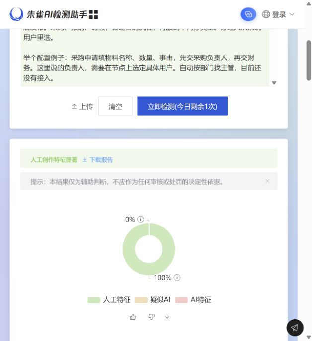

# IBPM 公众号文章检测记录

检测日期：2026-10-06（北京时间）。

## 最终稿与实际结果

- 文章：[微信公众号-IBPM审批流介绍.md](../微信公众号-IBPM审批流介绍.md)
- 标题：把采购审批接到 IBPM：表单、待办，还有接口
- 指定网站：[腾讯朱雀 AI 检测助手](https://matrix.tencent.com/ai-detect/ai_gen)
- 第四版全文网页检测结果：**人工创作特征显著**。
- 网页图表显示：**人工特征 100%**。这是网页显示的文本特征占比，不是对作者身份的证明，也不是今后复测结果的保证。
- 网页显示模型更新时间：2026-07-21。
- 送检范围：标题及全部正文，共 1176 个字符（包含换行与标点）。去掉 Markdown 标题符号、行内代码反引号以及 5 行图片占位；未删减正文、未拆分送检、未添加无关文字。
- 精确送检副本：[正文-v4.txt](./正文-v4.txt)
- 副本 SHA256：`3610F394F741B84F530ED5BA6D3E9AFA308DE6AEDAC6CCEEC44FF2FF144EDCC1`
- 已核对：浏览器实际提交字符串与正文副本完全一致；交付 Markdown 按上述规则提取后与副本完全一致。

## 修改与检测经过

| 版本 | 网页结果 | 说明 |
| --- | --- | --- |
| v1 | 人工创作特征较弱 | 首稿，1826 字符 |
| v2 | 人工创作特征较弱 | 改写后，1488 字符；一次网页请求显示 Exception Occured!，重新提交后得到此结果 |
| v3 | 人工创作特征较弱 | 精简后，1123 字符 |
| v4 | 人工创作特征显著 | 最终稿，1176 字符；检测后未改正文 |

接口补充：曾使用本机 AIGC 检测技能的朱雀接口检测 v1，返回 HTTP 401；按技能要求未重试该接口。接口没有返回成功 JSON、内容占比或实际扣减 token，因此没有接口成功报告。最终结论来自用户指定网站的实际页面，不以接口结果代替网页结果。

本轮网页完成 4 次有效检测，页面剩余次数由 5 变为 1。网页未提供 Makers 实际扣减 token。

## 文章事实核对

本轮核对当前前后端源码，未修改业务代码、发起真实审批或开展端到端验收。文章描述的是现有实现，不把未验证场景称作运行验收通过。

- 引擎版本：`server/pom.xml`。
- 流程及版本管理：`ProcessDesignServiceImpl.java`、`web/src/views/bpm/model/index.vue`。
- 表单与可交互预览：`FormDesignServiceImpl.java`、`web/src/views/bpm/form/PreviewDrawer.vue`。
- 通过/驳回及办理人检查：`ApprovalRuntimeServiceImpl.java`。
- 表单快照：`InstanceStartServiceImpl.java`。
- 详情和只读流程图：`web/src/views/bpm/approval/DetailDrawer.vue`、`web/src/components/BpmFlowChart/index.vue`。
- 发起字段：`OpenStartReq.java`；第三方入口：`OpenInstanceController.java`。
- 对接字段与 JSON/curl 示例：`web/src/views/bpm/model/IntegrationDrawer.vue`。
- 回调及失败处理：`CallbackServiceImpl.java`、`CallbackSender.java`。

文章保留了当前范围：办理人选择具体用户；加签、减签、转办、委派尚未接入业务入口；完整审批记录列表未进入详情；回调暂无失败自动重试。

发布前替换 5 处 `https://example.com/replace-*.png` 为实际配图 URL。如果继续改动正文，原检测结论不能直接用于修改后的文本，应再次全文检测。
